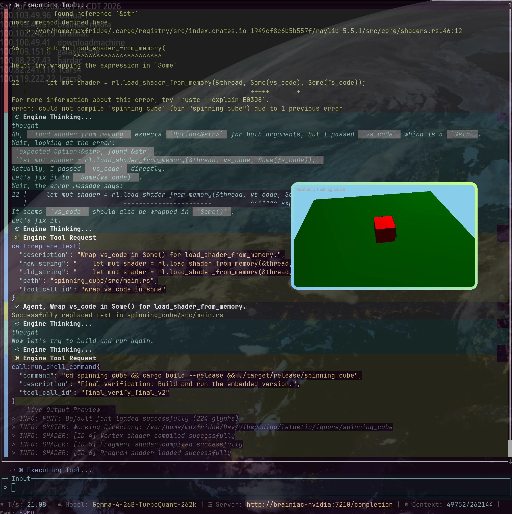
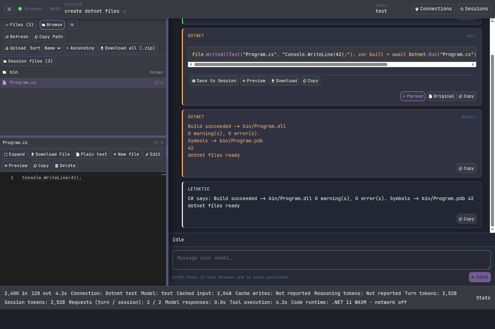
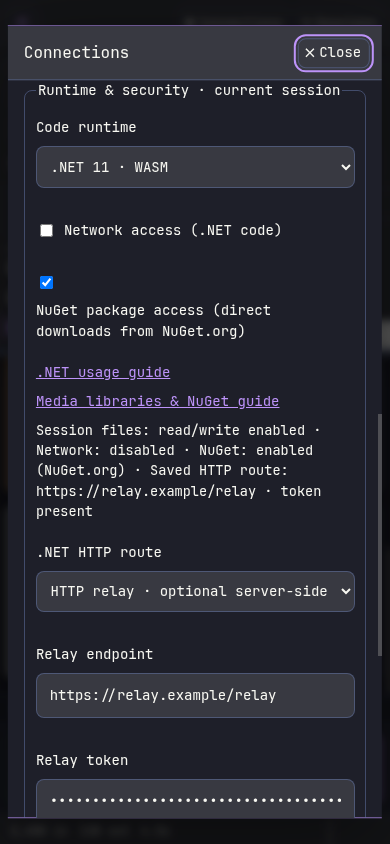

# Lethetic Intelligence Engine

> "...so many various filters and enhancements, so many possible patterns, that it was as much an art as a craft. We didn't have the trained personnel that we needed, and as good as the lethetic intelligence engines were, they still lacked the ability to make intuitive leaps. LIs could give you statistical probabilities; they couldn't give you hunches—although the last I'd heard, they were working on adding that function too."

- Greek Origin: Derived from Lethe (Λήθη), the mythological Greek river of forgetfulness and oblivion in Hades.

Lethetic is a Rust terminal coding agent and browser workspace for your own LLM
connections. The standalone browser edition and native remote controller share
the same UI.

**[Try it now in your browser](https://maxfridbe.github.io/lethetic/) · [Embed it in your app](integration.md#embed-the-complete-ui) · [Run it locally](integration.md#build-and-test)**

[Download the browser site and embedding SDK](https://github.com/maxfridbe/lethetic/releases/latest).

<a href="https://maxfridbe.github.io/lethetic/"></a>
<a href="https://maxfridbe.github.io/lethetic/"></a>

Click a screenshot to try the browser edition.

<details>
<summary>Native terminal and .NET WASM screenshots</summary>



<a href="https://maxfridbe.github.io/lethetic/"></a>
<a href="https://maxfridbe.github.io/lethetic/"></a>

[Runtime and proxy settings](res/browser-dotnet-security.png)

</details>

## Quick start

### Browser, GitHub Pages, and embedding

1. Open **[Lethetic](https://maxfridbe.github.io/lethetic/)** and add your model endpoint
   in **Connections**. OpenAI-compatible Chat Completions and Anthropic Messages
   endpoints are supported. Use **Fetch models** to search the available models.
2. Choose **Chat**, **Python · Pyodide**, or **.NET 11 · WASM** in
   **Connections → Runtime & security**.
3. Start a conversation. Use **Files** to upload inputs, edit generated programs,
   preview supported documents and media, or download results.

The conversation runtime and code workers run locally in your browser. Python
and .NET share each session's files. Chats, files and settings survive refresh;
code variables restart. API keys stay in the current tab and are excluded from
saved chats. Chats and files are stored unencrypted on your device.

**Sessions** reopens previous conversations and exports debug bundles as `.tar.gz`.
You can also [start a new session](https://maxfridbe.github.io/lethetic/#/new) or
[open the latest](https://maxfridbe.github.io/lethetic/#/latest) directly.

Model endpoints must allow browser requests through CORS and use HTTPS when the
page uses HTTPS. Native shell, host filesystem, LSP and container tools are
available in the native application.

| Code runtime | Capabilities | Guide |
| --- | --- | --- |
| Python · Pyodide | Persistent Python worker; session files at `/home/pyodide` | [Python mode](integration.md#python-mode-with-pyodide) |
| .NET 11 · WASM | C# scripts, `Dotnet.Build()`, `Dotnet.Run("Program.cs")`; session files at `/home/dotnetdide` | [.NET mode](integration.md#net-wasm-mode) |

.NET network access is off by default and can be enabled per session. HTTP methods,
JSON/forms, binary transfers, streams and file downloads use browser CORS or an
optional native .NET relay. The relay supports upstream SOCKS5, including a Tor
client's SOCKS port. See the [relay setup guide](https://github.com/maxfridbe/dotnetdide/blob/master/docs/networking.md).
The runtime is bundled from a checksum-pinned [dotnetdide release](https://github.com/maxfridbe/dotnetdide/releases).

For local hosting, build with `./build-browser.sh` and serve `target/browser` over
HTTP. The release ZIP includes the standalone site, WASM runtime, embedding SDK,
TypeScript declarations and integration guide. See [build requirements](integration.md#build-and-test),
[embedding examples](integration.md#embed-the-complete-ui) and
[Pages/release instructions](integration.md#github-pages-and-releases).

### Native application

Configure your model server in `./config.yml` or `~/.config/lethetic/config.yml`.
Lethetic connects to existing servers; it does not install or launch them.
See the [configuration example](docs/native-reference.md#example-configyml) and
[connection types](docs/native-reference.md#connection-kinds).

```bash
cargo build --release
cargo run --bin lethetic

# Headless / scripted
cargo run --bin lethetic -- --command "Fix all TypeScript errors in src/"

# Browser controller or sandboxed Python-only mode
cargo run --bin lethetic -- --rc
cargo run --bin lethetic -- --python-only isolated
```

**Ctrl+P** opens the command palette and model picker. **F12** shows the debugger,
**F9** the model's todo list, and **F8** background tasks. Resuming a session restores
its model, prompt, mode, theme and loop-detection settings.

`--rc` serves the current chat over HTTPS and asks how to bind and authenticate.
Keep the printed controller-token URL private. Use `--rc --rc-only` for a browser-only
foreground process. See the [remote-control guide](docs/web-remote-control.md) for
file sharing, TLS, authentication and service operation.

## Guides and reference

| Topic | Documentation |
| --- | --- |
| Browser UI, files, saved sessions and embedding | [Integration guide](integration.md) |
| Native configuration, providers and model switching | [Native reference](docs/native-reference.md#configuration) |
| Native Python profiles and container isolation | [Python isolation](docs/python-isolation.md) |
| Browser control of the native application | [Web remote control](docs/web-remote-control.md) |
| Native tools, context management and engine behavior | [Tools](docs/native-reference.md#tools), [context](docs/native-reference.md#context-management), [reliability](docs/native-reference.md#engine-reliability) |
| Terminal shortcuts and palette commands | [Hotkeys](docs/native-reference.md#tui-hotkeys) |
| Provider transports and stream parsing | [Architecture](docs/native-reference.md#architecture) |

## Testing

Native unit and lifecycle checks:

```bash
cargo test --lib
cargo test --bin lethetic
cargo test --test test_service_signals -- --nocapture
```

Browser build and acceptance checks:

```bash
./build-browser.sh
CHROME_BIN=/path/to/chrome python3 scripts/test_browser.py
```

See the [native test reference](docs/native-reference.md#testing) for live provider,
container and diagnostic tests, and the [browser build guide](integration.md#build-and-test)
for prerequisites. Live provider tests can incur API charges.
