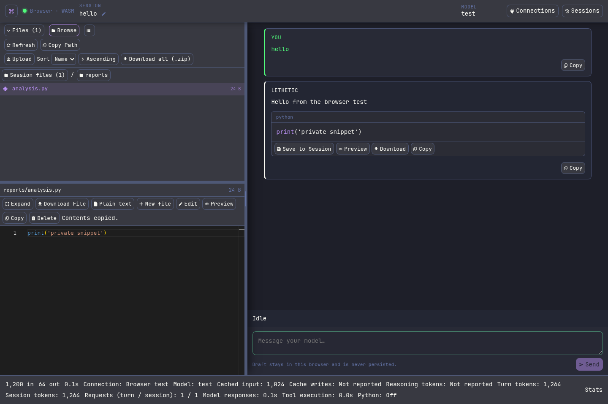
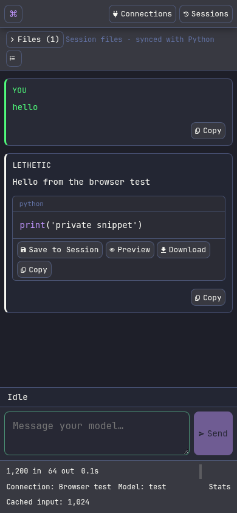

<h1></h1>

> "...so many various filters and enhancements, so many possible patterns, that it was as much an art as a craft. We didn't have the trained personnel that we needed, and as good as the lethetic intelligence engines were, they still lacked the ability to make intuitive leaps. LIs could give you statistical probabilities; they couldn't give you hunches—although the last I'd heard, they were working on adding that function too."

**Lethetic is an LLM harness for exploring new and better ways to interact with
language models.** It brings model connections, tools, code execution, context
management, and interfaces together in a workspace you control.

The ambition is to become the fastest and most versatile harness across LLMs:
make interactions responsive, try different workflows, and carry useful ideas
across models and runtimes. Speed and broad compatibility are goals we build and
test toward. Today, Lethetic connects to local and hosted models through supported
OpenAI-compatible and Anthropic Messages endpoints.

**[Try it now](https://maxfridbe.github.io/lethetic/) · [Run locally](docs/how-to/native.md) · [Embed it](docs/how-to/embedding.md) · [Download releases](https://github.com/maxfridbe/lethetic/releases/latest)**

Click either screenshot to try it. [More screenshots](docs/screenshots.md).

## What you can explore

- **Models and interaction:** bring your own connections, switch models, tune
  prompts, stream responses and available thinking, and inspect usage and context.
- **Tools and execution:** use native tools, a Python-only or C#-only runspace,
  or browser WASM runtimes with session files and interactive site previews.
- **Interfaces:** work in the terminal, automate a headless run, control the
  native engine from a browser, or run the harness entirely in a browser.
- **Control and visibility:** adjust turn budgets and loop detection, compact
  context, inspect diagnostics, and choose execution and network permissions.

Rust is the core. Portable CLI code also builds to WASM, and the standalone browser
and native remote controller share their web UI. The browser still has its own
orchestration adapter; [full CLI parity remains in progress](docs/browser-parity.md).

## Start in the browser

1. [Open Lethetic](https://maxfridbe.github.io/lethetic/) and add your endpoint,
   model, and API key in **Connections**. **Fetch models** helps you choose a model.
2. Select **Chat**, **Python · Pyodide**, or **.NET 11 · WASM** in
   **Connections → Runtime & security**.
3. Send a prompt. In code modes, use **Files** to upload inputs and preview or
   download generated results.

The endpoint must permit browser requests through CORS. Chats and files are saved
locally on your device; model requests go to your chosen provider. See the
[browser guide](docs/how-to/browser.md) for setup, sessions, and permissions.

## How-To guides

Choose where the engine should run, then choose its tools. Remote control uses the
native engine; browser-only mode runs the harness and code workers in your browser.

| Mode | Use it for | Guide |
| --- | --- | --- |
| Browser-only | Chat and work with session files without installing the native application | [Use the browser workspace](docs/how-to/browser.md) |
| Native web UI | Use the shared WASM UI on Windows, macOS, Linux or Android, with virtual or selected real folders | [Build and use the native app](docs/how-to/native-web-ui.md) |
| Native terminal / headless | Work with a local project and native tools, interactively or from scripts | [Run the native harness](docs/how-to/native.md) |
| Remote control (`--rc`) | Use the browser UI to control the native engine and its tools | [Control a native session](docs/how-to/remote-control.md) |
| Python-only | Execute Python in Pyodide or a selected native isolation profile | [Work in Python](docs/how-to/python.md) |
| .NET-only | Execute C# in DotnetDide WASM or an isolated native SDK container | [Work in C#](docs/how-to/dotnet.md) |
| Embedded | Add the browser UI or headless SDK to your own application | [Embed the harness](docs/how-to/embedding.md) |

## Technical reference

| Topic | Documentation |
| --- | --- |
| Execution boundaries and data flow | [Architecture diagrams](docs/architecture.md) |
| Native providers, configuration, tools, and shortcuts | [Native reference](docs/native-reference.md) |
| Python backends, network policies, and retained packages | [Python isolation](docs/python-isolation.md) |
| Native C# runspace and container lifecycle | [Native .NET](docs/dotnet-native.md) |
| Remote authentication, TLS, and file disclosure | [Remote-control reference](docs/web-remote-control.md) |
| Browser APIs, files, limits, hosting, and releases | [Integration reference](integration.md) |
| Shared CLI/WASM behavior and remaining gaps | [Browser parity](docs/browser-parity.md) |
| Relational session schema, SQL queries, migration, and SQLite exports | [Embedded storage](docs/storage.md) |
| Builds and validation | [Development checks](docs/development.md) |

## The name

Greek Origin: Derived from Lethe (Λήθη), the mythological Greek river of
forgetfulness and oblivion in Hades.
