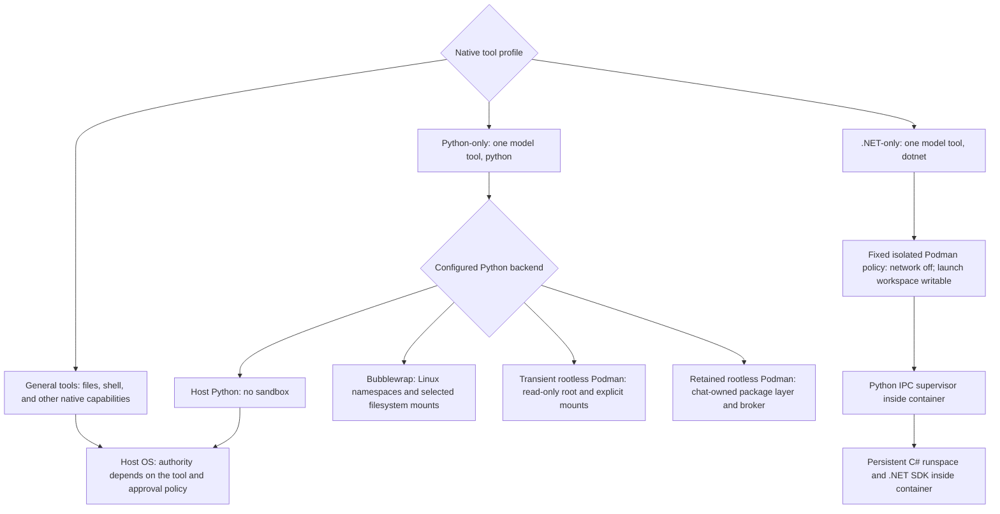
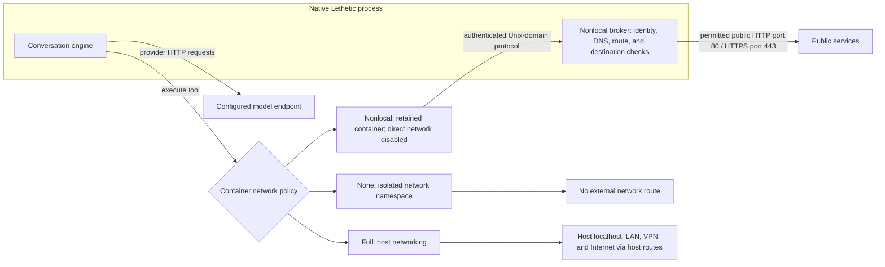
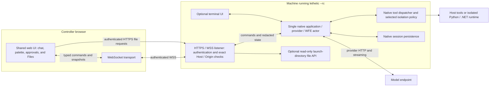
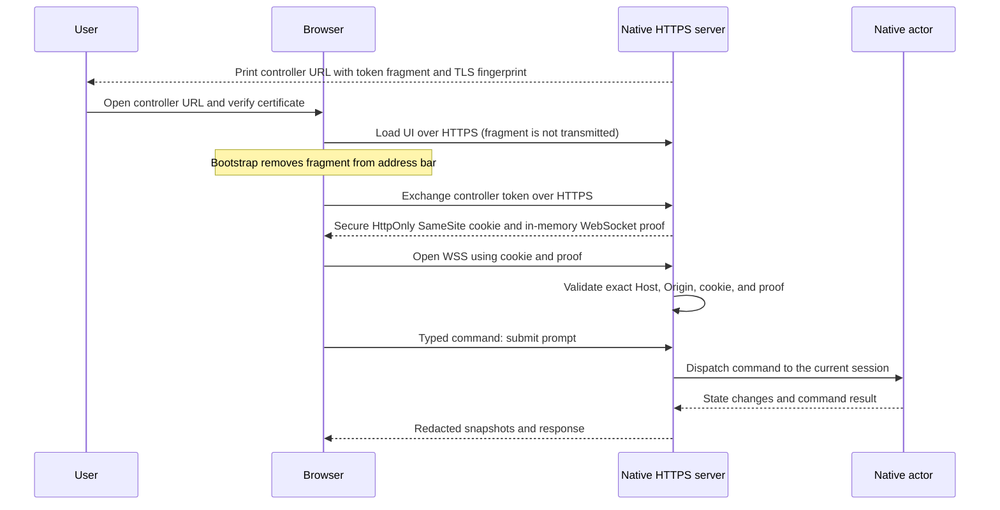
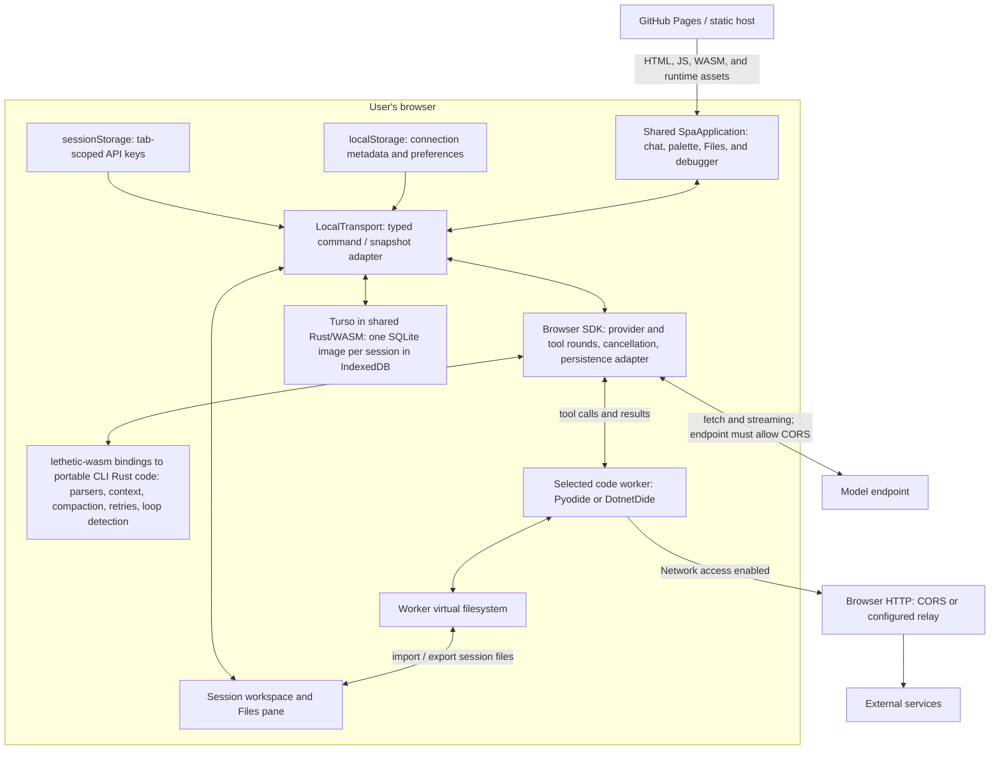
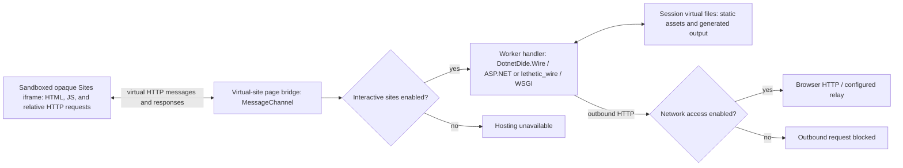

# Execution, isolation, and browser architecture

These diagrams describe the current implementation. GitHub renders the Mermaid
blocks directly. Boxes group execution locations; arrows show commands, data, or
allowed access. A grouped box alone does not imply a security boundary.

## Isolation modes

The **tool profile** determines what the model can call. The **execution backend**
determines where that code runs and what it can access. Choosing a browser UI does
not change the native process's tool isolation policy.

| Backend | Filesystem access | Tool networking | Lifetime |
| --- | --- | --- | --- |
| Host Python | Host user's filesystem permissions; cwd is not confinement | Host network | Worker process |
| Bubblewrap Python | Selected runtime files, workspace, and configured grants in Linux namespaces | None or Full; Nonlocal is unsupported | Worker process |
| Transient Podman Python | Read-only container root, temporary directories, workspace and explicit grants | None or Full | Worker/container |
| Retained Podman Python | Chat-owned writable package layer, workspace, and narrowly scoped broker resources | Nonlocal broker; direct container network disabled | Retained chat runtime with 14-day TTL |
| Native .NET | Read-only container root, temporary directories, writable launch workspace; `.lethetic` masked | Always None | Persistent runspace in transient Podman |
| Browser Pyodide / DotnetDide | Browser virtual filesystem synchronized with session files | Browser HTTP subject to permissions and CORS; optional HTTP relay | Worker; files persist separately |

Native .NET uses the same isolated Podman infrastructure as Python. Its SDK and
internal Python supervisor are in the image; it does not fall back to a host SDK
or DotnetDide. Browser .NET uses DotnetDide instead. Neither a Python-only nor a
.NET-only tool surface, by itself, describes a filesystem security boundary.

### Native container network policies

The model connection runs outside the tool container. **Disabling tool network
access does not disable model requests.** Nonlocal blocks local/private and other
non-global destinations; it is not a domain allowlist. Full allows host network
reachability but does not grant host filesystem access by itself.

These invocation-locked modes use the launch directory at the same absolute path,
read/write, mask its `.lethetic` control directory, and disallow extra path grants:

| Invocation | Backend and network |
| --- | --- |
| `--python-fully-isolated` / `--python-only isolated` | Transient Podman, None |
| `--python-isolated-with-nonlocal-network` / `--python-only nonlocal` | Retained Podman, Nonlocal, explicit session package helper |
| `--python-isolated-permissive` / `--python-only permissive` | Transient Podman, Full |
| `--dotnet-only` | Transient Podman, fixed None policy |

Ordinary configured Python policies can have different workspace bindings and
grants; retained Nonlocal configuration uses a managed workspace unless selected
through a literal CLI mode. Backends fail closed rather than silently falling
back to Host. Containers and namespaces share the host kernel; they are not VMs.
See [Python isolation](python-isolation.md) and [native .NET](dotnet-native.md) for
the full policy and lifecycle rules.

## Remote control: `-rc` / `--rc`

Remote control serves the shared web UI from the native application. The native
machine owns the conversation, credentials, provider requests, tools, and durable
session. The browser sends commands and displays a redacted projection of state.

The terminal and browser control the same actor. `--rc-only` (alias `--service`)
removes the interactive TUI surface; the engine still runs natively. Browser
disconnects do not terminate the engine. `--rc-files` enables the separate,
read-only file API rooted at the pinned launch directory, subject to disclosure
rules; it does not grant the model new filesystem permissions.

### Default controller authentication

Explicit tokenless mode (`--rc-open`) allows every reachable peer to obtain control;
HTTPS and process-binding checks remain, but do not authenticate the person.
See [remote control](web-remote-control.md) for TLS, file access, and service setup.

## Browser-only mode

GitHub Pages or another static server delivers assets. The browser owns the
conversation and sends provider requests directly. The shared UI uses a local
transport instead of the native WebSocket transport.

The hosted application stores chats and files unencrypted locally using the
[shared embedded Turso schema](storage.md). Each native session stores content in
`.lethetic/sessions/<session>/lethetic.db`; `python.ipynb` remains a Jupyter notebook file. API keys are
excluded from saved chats and connection metadata; tab-scoped storage retains them
across refresh. Embedding hosts can supply their own storage options. Restoring a
session restores files and history, not worker variables or running programs.
Python's session root is `/home/pyodide`; .NET's is `/home/dotnetdide`.

Portable Rust behavior is reused, but full native orchestration parity is not yet
complete: the browser SDK still drives its own model/tool rounds. Browser-only
mode has no native shells, Podman, LSP processes, or unrestricted OS sockets.
See [shared-core status](browser-parity.md) for what is shared and what remains.

### Interactive sites and permissions

Virtual ports route browser requests to worker handlers; they do not open TCP
listeners on the user's machine. The current Sites preview uses an opaque iframe
and a message bridge, not a service worker. .NET route responses support streaming;
Python uses the buffered response adapter. Classic scripts and relative site
requests work; direct external requests from iframe JavaScript, ES modules, and
WebSockets are unavailable. External HTTP goes through the Python or C# handler.
Interactive sites and outbound Network access
are separate, default-off permissions. A local site can run without external
network access. NuGet package access is a third, separate .NET permission, also
off by default; compatible packages use browser downloads and Cache Storage.
Browser network permission does not bypass CORS or enable raw SOCKS sockets;
a configured native HTTP relay can provide upstream proxy routing.

See the [browser integration guide](../integration.md),
[Python sites](../integration.md#interactive-python-sites), and
[.NET sites](../integration.md#run-saved-programs-and-interactive-sites) for examples.

## Implementation map

| Diagram area | Implementation |
| --- | --- |
| Native Python policy and backends | [`src/config.rs`](../src/config.rs), [`src/python/backend.rs`](../src/python/backend.rs), [`src/python/retained_podman.rs`](../src/python/retained_podman.rs) |
| Native .NET isolation and supervisor | [`src/dotnet/mod.rs`](../src/dotnet/mod.rs), [`runtime/dotnet`](../runtime/dotnet) |
| Remote listener, authentication, actor, and file API | [`src/wfe`](../src/wfe), [`web/src/transport.ts`](../web/src/transport.ts) |
| Shared web UI | [`web/src/app.tsx`](../web/src/app.tsx) |
| Browser transport, engine adapter, and persistence | [`browser/src/local-transport.ts`](../browser/src/local-transport.ts), [`browser/src/sdk.ts`](../browser/src/sdk.ts), [`browser/src/session-storage.ts`](../browser/src/session-storage.ts) |
| Portable Rust exports | [`lethetic-wasm/src/lib.rs`](../lethetic-wasm/src/lib.rs), [`src/engine`](../src/engine) |
| Browser workers and virtual sites | [`browser/src/python.ts`](../browser/src/python.ts), [`browser/src/dotnet.ts`](../browser/src/dotnet.ts), [`browser/src/sites-dialog.ts`](../browser/src/sites-dialog.ts) |
