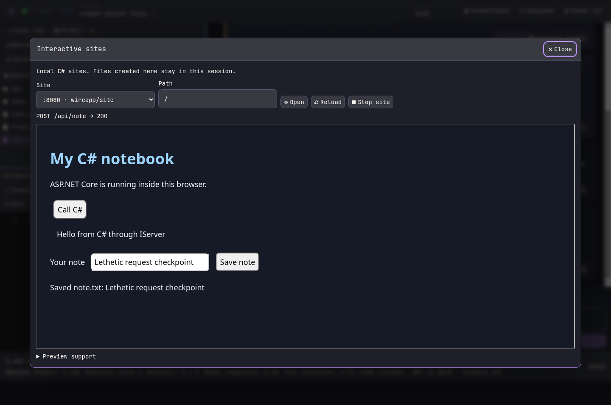
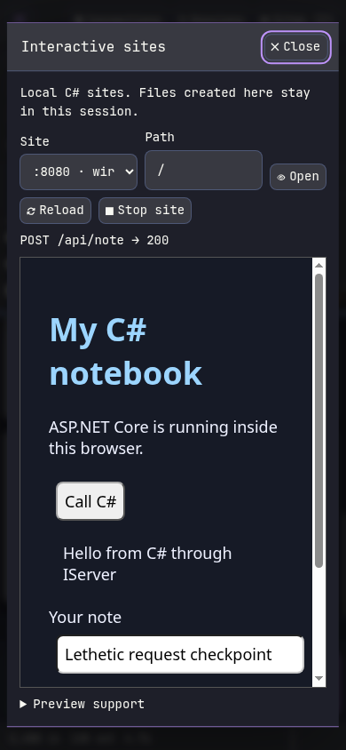
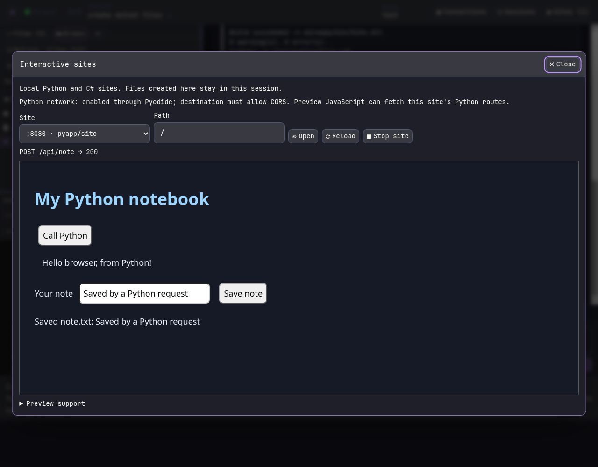
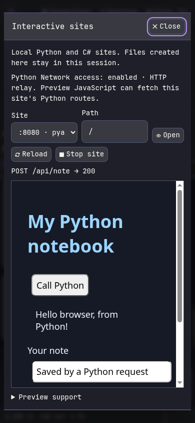

# Lethetic in pictures

[Back to README](../README.md) · [Try the browser edition](https://maxfridbe.github.io/lethetic/)

## Terminal

## Browser C# workspace

## Interactive C# sites

## Interactive Python sites

[Runtime and proxy settings](../res/browser-dotnet-security.png)

