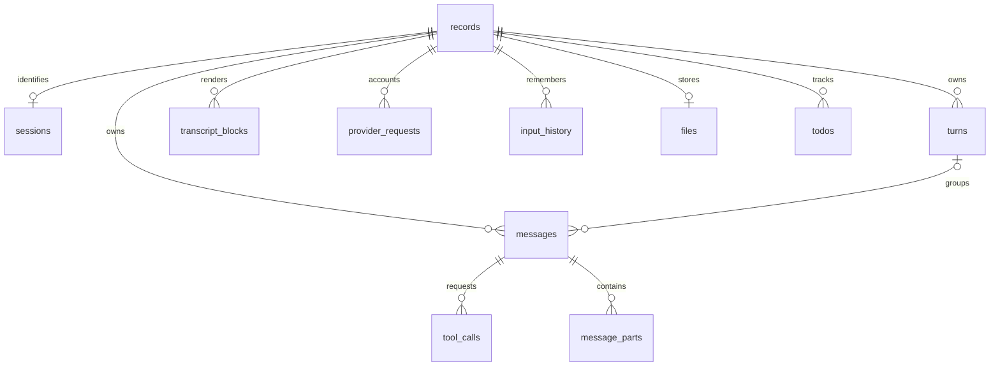

# Embedded session storage

Lethetic embeds [Turso](https://github.com/tursodatabase/turso), a Rust database
engine with a SQLite-compatible file format. The engine is linked into the native
binary and compiled into `lethetic_wasm_bg.wasm` for the browser. No database server,
Turso account, npm database package, or network connection is needed for storage.

## Native and remote-control sessions

Each durable session has its own `.lethetic/sessions/<session>/lethetic.db`:

- Durable session state, model messages, transcript blocks, and input history.
- Transcript and diagnostic logs, token recordings, and request diagnostics.

Shared input history, todos, and project-scoped tool/background artifacts use a
separate `.lethetic/lethetic.db`. Changing or deleting one session does not rewrite
another session database.

`python.ipynb` remains a normal Jupyter notebook file. Isolation policies,
configuration, directory identity, lifecycle records, and locks also remain files;
they establish boundaries that must be checked before opening content. Session
directories still identify individual sessions. Remote control uses the native
engine and its database; it does not create a second browser session database.

Each database uses its own OS lock across processes, transactions, and a write-ahead log.
Writes to database and WAL paths retain the existing no-follow/ownership checks.
Normal shutdown checkpoints the WAL. Use an exported copy, or stop Lethetic before
opening a database with external SQLite tools or copying it with ordinary file
tools. Lethetic coordinates its writers through its own lock file. Do not discard
a WAL after an interrupted run.

Existing session content is imported when the session opens. Other legacy content
is imported when accessed or updated. Imports commit before removing the original
content files. If importing fails, the source remains available. Do not run an old
file-storage version against the same project while using this version.

Historical artifact paths such as `.lethetic/sessions/<name>/tokens.jsonl` are
logical database record names. Playback, compaction, `read_file`, `read_file_lines`,
and `summarize_content` understand them. Ordinary shell tools should read an export
or query the database instead.

## Browser and embedding

The hosted app stores **one complete Turso database image per session** in IndexedDB
`lethetic.sessions.v2`, keyed by session ID. A small catalog holds IDs and the save
revision. Session metadata, messages, transcript blocks, usage and files use the same
relational SQL schema as the native host, with browser-specific scopes. Saving a chat rebuilds only its database;
other session images stay unchanged. Files are binary BLOBs, not base64
in the database. Runtime snapshots retain their existing JSON representation.

Existing localStorage sessions, previous IndexedDB binary records, and the earlier
aggregate database image migrate automatically into separate session databases.
The catalog and changed images commit in one IndexedDB transaction. A revision
check prevents a stale tab from overwriting another save. Failed commits leave the previous database intact, with unsaved edits still
in the tab. Existing workspace, session-size, and browser disk-quota limits apply.
Portable in-memory database images have a 512 MiB safety bound; native databases
do not have that image-size cap.

**Sessions → Database (.db)** downloads a portable SQLite database containing the
selected session and its files. API keys are excluded from connection metadata.
This is a content export; user-written text and files are preserved verbatim.
The debug `.tar.gz` export remains available. Database downloads are inspectable
with SQLite tools; automatic cross-host database import is not provided.

Embedding hosts opt into the same persistence adapter:

```js
import { mountLethetic, openBrowserStorage } from "./src/embed.js";
const storage = await openBrowserStorage(localStorage);
const app = mountLethetic(document.getElementById("app"), { storage });
// Before tearing down the host:
await storage.flush();
app.destroy();
storage.close();
```

Passing plain `localStorage` explicitly retains the legacy embedding adapter.
Omitting storage keeps the embedded session in memory.

## Relational schema and queries

Schema version **3** stores conversation data in relational tables. The exact
DDL compiled into both native and WASM builds is [schema.sql](../src/storage/schema.sql).
There is no `content_records` table and no serialized session BLOB. Resuming a
session reconstructs the application's transport objects from these rows.

| Table | Queryable data and relationships |
| --- | --- |
| `sessions` | Session ID, name, system prompt, theme, model/settings, permissions, timing |
| `messages` | Ordered model history: role, content, error flag, turn index, result call ID |
| `turns` | User-message boundaries and first message position |
| `tool_calls` | Message FK, call/provider IDs, function name, arguments JSON |
| `message_parts` | Message FK, ordered provider parts, type, text, provider extensions |
| `transcript_blocks` | Ordered UI transcript: kind, content, title, tool payload, outcome, duration, usage, cost |
| `provider_requests` | Request ID, logical turn ID, connection, model, token counts, cost, completion state |
| `usage_totals` | Native/browser session and latest-turn accounting summaries, report counts, latest browser response usage |
| `tool_statistics` | Tool name and call count |
| `connections` | Browser connection name, provider, endpoint, model, thinking; excludes API keys |
| `input_history` | Ordered user inputs |
| `files`, `file_entries`, `directories` | Browser file bytes, ordered metadata, modification times, empty directories |
| `todo_lists`, `todos` | Project todo revision and individual items, status and priority |
| `text_chunks` | Ordered raw text logs and diagnostic artifacts |
| `binary_chunks` | Opaque binary artifacts only |
| `records` | Logical import/export names and namespaces; no content payload |

Each top-level entity links to `records.id` through `record_id`. Tool calls and
provider parts link to `messages.id`. Foreign keys enforce ownership, deletions
cascade, and unique indexes enforce collection ordering. A native session uses
an empty scope; browser metadata uses `browser/sessions`. The shared project DB
uses the same tables for project history, todos and artifacts.



`turns` groups the *retained model history* by user-message boundary. Compaction
can change those indexes; they are not invented historical turn UUIDs. Native
accounting retains the original `logical_turn_id` in `provider_requests` and
`transcript_blocks`. The `logical_turn_usage` view groups recorded requests by that
ID and currency. Browser snapshots currently retain aggregate usage, not a complete request
ledger; storage does not manufacture missing request history.

Open an exported `.db`, or a stopped/checkpointed native session, using SQLite:

```sql
-- Read conversation history without parsing JSON.
SELECT s.session_id, m.position, m.role, m.content
FROM sessions s JOIN messages m ON m.record_id = s.record_id
ORDER BY m.position;

-- Inspect Python tool calls and their owning assistant messages.
SELECT m.position, t.call_id, t.function_name,
       json_extract(t.arguments_json, '$.code') AS code
FROM tool_calls t JOIN messages m ON m.id = t.message_id
WHERE t.function_name = 'python'
ORDER BY m.position, t.position;

-- Join results back to their calls (within the same snapshot).
SELECT t.call_id, t.function_name, result.content, result.tool_result_is_error
FROM tool_calls t
JOIN messages caller ON caller.id = t.message_id
JOIN messages result ON result.record_id = caller.record_id
                   AND result.result_call_id = t.call_id;

-- Native provider usage and estimated/charged costs, by model/currency.
SELECT model, cost_currency, COUNT(*) AS requests,
       SUM(output_tokens) AS output_tokens, SUM(cost_nanos) AS cost_nanos
FROM provider_requests
GROUP BY model, cost_currency;

-- Browser session files, with byte sizes and modification dates.
SELECT session_id, path, size_bytes, modified_at FROM session_files;

SELECT content, status, priority FROM todos WHERE status <> 'completed';
```

JSON remains appropriate for arbitrary tool arguments, provider-specific fields,
and runtime policy/configuration extensions. `extra_json` holds these extensions
and empty collection markers, **not duplicate messages, transcripts or session
payloads**. `fields_json` records field presence and original types so missing,
null, empty, and decimal-string WFE counters round-trip correctly. Domain columns
remain authoritative. Ordinary counters use SQL integers; unsigned values beyond
SQLite's signed 64-bit range are retained as decimal-byte BLOBs to avoid rounding.
Tool statistic counts use exact decimal text.

The shared WASM API also exposes parameterized SQL for embedding hosts:

```js
import { contentDatabaseFactory } from "./src/sdk.js";
const Database = await contentDatabaseFactory();
const db = new Database(storage.exportDatabase(sessionId));
try {
  const { columns, rows } = JSON.parse(db.query(
    "SELECT position, content FROM messages WHERE role=? ORDER BY position",
    JSON.stringify(["user"]),
  ));
  console.table(rows.map(row => Object.fromEntries(columns.map((key, i) => [key, row[i]]))));
} finally {
  db.free();
}
```

This operates on that database instance. SQL mutations do not automatically save
into the app's active session or IndexedDB. Exported database import is not yet a UI
feature. BLOB query cells are returned as byte arrays.

Version-1 `content_records` databases migrate in a single transaction: parse and
insert all domain rows, remove the old table, then set `user_version=4`. A failure
rolls back the migration. Browser upgrades replace the IndexedDB images only after
the new databases are complete. Legacy files likewise remain until their import
commits; `python.ipynb` stays a normal notebook.

To extract a raw transcript log without losing chunk boundaries:

```python
import sqlite3
from pathlib import Path

with sqlite3.connect("file:session.db?mode=ro", uri=True) as db:
    chunks = db.execute(
        "SELECT c.content FROM text_chunks c JOIN records r ON r.id=c.record_id "
        "WHERE r.scope=? AND r.name=? ORDER BY c.ordinal",
        ("", "ui_log.txt"),
    )
    Path("transcript.txt").write_text("".join(row[0] for row in chunks), encoding="utf-8")
```

### Provider diagnostics

Browser sessions retain provider attempts separately from model history in
`provider_traces`. Each row has a turn ID, round/attempt number, provider/model,
timestamps, outcome, HTTP status, request body, response head/tail, byte counts,
completion/redaction flags and error. These remain queryable after a failed
turn rolls back its model history. Version 2 databases migrate transactionally
by adding this table; existing conversation rows remain unchanged.

```sql
SELECT turn_id, round, attempt, http_status, outcome, error,
       response_head, response_tail, response_omitted_bytes
FROM provider_traces ORDER BY position;
```

Sessions → Export debug bundle includes `provider-traces.jsonl`. Capture happens
before SSE/JSON parsing and retains malformed tool arguments, partial responses,
retries and cancellations. HTTP error bodies retain at most 64 KiB (head/tail of received text), with
`responseComplete=false` if reading stops at that limit. Known connection keys and relay credentials are
redacted before storage; authorization headers are never recorded. Request and
response bodies can still contain conversation and tool content.

Limits: 16 recent attempts and 8 MiB per session, 128 KiB per request body,
1 MiB per response (first and last 512 KiB). Small embedding stores reduce the
per-session trace budget to one quarter of their storage limit, truncating the
latest attempt if needed. Omitted request/byte counts are
explicit. Head and tail concatenate only when no response bytes were omitted.
`responseComplete` indicates EOF or protocol end was observed, independently
of parsing success. Pending traces exported during a turn are snapshots.
Completed attempts persist with the session at the end of the turn; closing a
tab mid-turn can lose the current turn's diagnostics. Existing reports cannot
recover response data discarded before this capture was introduced.

Schema v4 adds `sessions.network_mode` (`direct` or `tor`) alongside the network
permission. Existing v2/v3 databases migrate transactionally; an absent mode
retains direct networking. Tor-only sessions never silently acquire direct HTTP
when reopened in a browser without the native Tor client.
